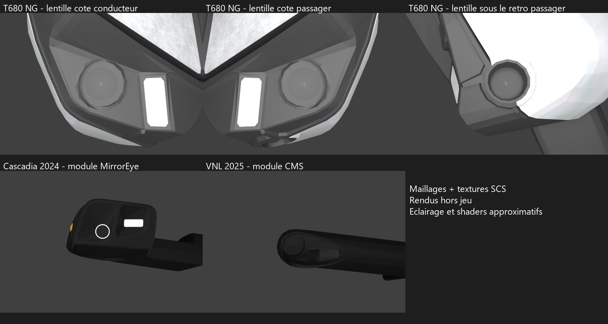
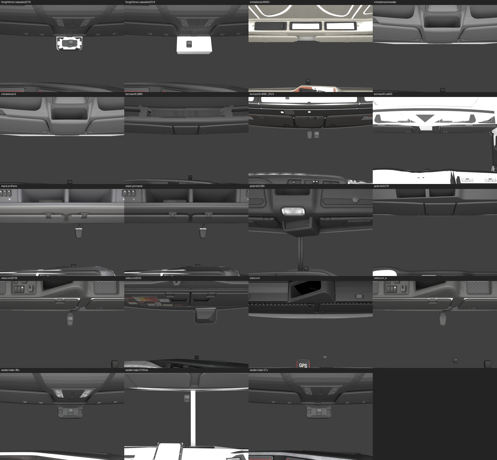

# Caméras physiquement modélisées dans ATS : examen 3D

Examen du stock installé le 25 octobre 2026, sans mods. Ce complément répond
à la question des **objets présents dans les modèles 3D du jeu**. Les brochures
constructeur du [premier relevé](truck-camera-audit-20261025.md) ne servent pas
à certifier la présence physique dans ATS.

Le T680 NG a ensuite fait l’objet d’une [passe complète de ses variantes de pièces](t680-camera-variants-20261025.md), au-delà de la sélection initiale ci-dessous.

## Résultats directement vérifiés

| Famille | Équipement physique dans le modèle SCS | Condition |
| --- | --- | --- |
| Kenworth T680 NG (`kenworth.t680_2022`) | Trois surfaces de lentille texturées : une en partie basse de l'ensemble de rétroviseur conducteur, deux sur l'ensemble passager, dont une sous le boîtier. | Accessoire DigitalVision `camera_chrome` ou `camera_paint` ; pas une preuve concernant un exemplaire équipé de rétroviseurs classiques. |
| Freightliner Cascadia 2024 | Modules MirrorEye en bout de bras, en partie haute des côtés de cabine. Ouverture optique circulaire sur la face regardant vers l'arrière. L'élément jaune sur l'autre face est un feu, pas la lentille. | Accessoires `camera_only`, `camera_chrome` ou `camera_plastic`, variantes cabine/day. |
| Volvo VNL 2025 | Modules CMS sur les bras latéraux hauts ; ouverture optique sur la face arrière du boîtier. | Accessoires `cam_chrome_dc`, `cam_chrome_s`, `cam_paint_dc` ou `cam_paint_s`. |



Ces images sont des **rendus hors jeu des vrais PMG et textures SCS**.
L'éclairage et les matériaux sont approximatifs ; ce ne sont ni des captures
ATS ni des images inventées. Les surfaces blanches de réflexion sont des
approximations du rendu natif des rétroviseurs.

### Preuve précise pour le T680 NG

Dans `/vehicle/truck/kenworth_t680_2022/accessory/mirror/camera_chrome.pmg`,
la pièce 3 contient 47 sommets et trois composantes de triangles distinctes
(17, 15 et 15 sommets). Ces surfaces utilisent le matériau
`/automat/20/20215ca47da9e8ce.mat`, dont la texture de base est
`/vehicle/truck/kenworth_t680_2022/cabin_details_difspec.tobj`.
Les UV couvrent précisément le disque photographique de lentille de cet atlas.
La correspondance géométrie + UV + image est donc établie, indépendamment du
nom de l'accessoire. Les deux versions de finition ont cette texture.

Les centres bruts des trois composantes sont conservés dans
[geometry.json](references/truck-cameras/mesh-20261025/geometry.json).
Ce sont des coordonnées locales de l'accessoire, **pas des coordonnées monde
ou des positions de montage complètes**. Aucune pose vidéo à ces coordonnées
n'a été ajoutée au plugin.

## Examen des 19 familles

Une variante représentative d'intérieur/cabine a été sélectionnée par famille,
complétée par les accessoires caméra identifiés et le rétroviseur classique
T680. Au total : 67 PMG et leurs matériaux/dépendances extraits, sans erreur.
Les variantes de matériau/équipement présentes dans un même PMG peuvent se
superposer : les rendus servent à examiner les pièces, pas à reproduire la
configuration exacte d'un camion assemblé.

| Famille | Résultat de l'examen physique sélectionné |
| --- | --- |
| T680 NG / 2022 | Trois lentilles DigitalVision confirmées sur l'option caméra ; petits boîtiers au pare-brise examinés, fonction optique supplémentaire non certifiée. |
| Cascadia 2024 | Modules physiques MirrorEye confirmés ; boîtier au pare-brise également présent, sans attribution supplémentaire certaine. |
| VNL 2025 | Modules physiques CMS confirmés ; boîtier central haut présent, sans caméra supplémentaire certifiée. |
| Cascadia 2019 | Grand boîtier central haut au pare-brise visible. La face examinée ne permet pas de certifier une lentille supplémentaire. |
| Western Star 49X | Boîtier central haut visible ; lentille non identifiée avec certitude. |
| Western Star 57X | Boîtier central haut visible ; lentille non identifiée avec certitude. |
| Western Star 5700XE | Aucune lentille supplémentaire identifiée dans les vues sélectionnées. |
| Mack Anthem | Petit boîtier suspendu en haut du pare-brise visible ; pas de lentille certifiée. |
| Mack Pinnacle | Petit boîtier suspendu en haut du pare-brise visible ; pas de lentille certifiée. |
| Volvo VNL 2018 | Petit boîtier central au pare-brise visible ; pas de lentille certifiée. |
| Volvo VNR Electric | Petit boîtier central au pare-brise visible ; pas de lentille certifiée. |
| International LT | Pas de lentille certifiée. Le fichier `sensor_color.tobj` montre des voyants colorés, pas une image de lentille ; son nom n'est pas une preuve de caméra. |
| International LoneStar | Aucune lentille identifiée avec certitude dans les vues sélectionnées. |
| International 9900i | Aucune lentille identifiée avec certitude dans les vues sélectionnées. |
| Kenworth T680 classique | Aucune lentille identifiée avec certitude dans les vues sélectionnées. |
| Kenworth W900 | Aucune lentille identifiée avec certitude dans les vues sélectionnées. |
| Peterbilt 389 | Aucune lentille identifiée avec certitude dans les vues sélectionnées. |
| Peterbilt 579 ancien | Aucune lentille identifiée avec certitude dans les vues sélectionnées. |
| Volvo VNL ancien | Aucune lentille identifiée avec certitude dans les vues sélectionnées. |



**« Non identifiée » ne signifie pas « absente de tous les modèles ».** Cette
passe n'est pas une inspection exhaustive de chaque cabine, finition, pièce
optionnelle, LOD, capot, pare-chocs, remorque ou installation de flotte. Les
petites ouvertures intégrées aux textures de vitrage peuvent aussi demander
un examen dédié. Il serait injustifié de certifier zéro caméra sur les seize
autres familles à partir de cette sélection.

Les boîtiers ne sont pas automatiquement classés ADAS : une forme noire au
pare-brise peut appartenir à un capteur, un boîtier de péage ou un appareil dont
la face optique n'est pas visible. Le constructeur peut documenter une caméra
réelle sans que cette inspection prouve sa reproduction dans le stock SCS.

## Conséquence pour BetterGPS

Les caméras des rétroviseurs sont un équipement différent d'une caméra de nez
ou de recul reliée au NavPlus. Cette inspection ne confirme pas d'installation
physique de ces dernières sur le T680 NG. La page « No camera available »
choisie par l'utilisateur reste donc inchangée. Aucun flux caméra, réglage,
fichier de jeu ou code du plugin n'a été modifié.

## Reproduction

1. Construire AssetInspector et exécuter `--camera-inventory` comme indiqué dans
   le premier relevé ; le JSON fournit maintenant tous les `modelPaths`.
2. Exécuter le même outil avec la sortie `build/camera-audit-20261025/mesh` et
   le drapeau `--mesh-audit`. Le relevé `stock` est attendu dans le dossier voisin.
3. Convertir les DDS de travail, sans modifier leurs sources :

```powershell
python BetterGPS/Overlay/scripts/render_camera_mesh_audit.py --data build/camera-audit-20261025/mesh --output build/camera-audit-20261025/renders --decode-textures
```

4. Lancer Blender 4.4 en arrière-plan avec le même script, après `--` fournir
   `--data`, `--output`, et `--view inside`, `front` ou `hardware`. Ajouter
   `--truck kenworth.t680_2022` pour limiter à une famille.

Le script ignore les surfaces de vitrage et de shadow-only pour exposer les
pièces, emploie les UV du premier canal et ne reproduit pas les shaders,
animation squelettique ou masques de variantes SCS. Deux textures de réflexion
BGRA de travail n'étaient pas prises en charge par Pillow ; elles ne sont pas
les textures de lentille utilisées pour la preuve T680. Les gros plans T680
ont été cadrés sur les centres des trois surfaces du JSON.

Le [manifest pérenne](references/truck-cameras/mesh-20261025/geometry.json)
conserve les chemins et SHA-256 des 67 PMG. Les PMD/PMG, matériaux, images
intermédiaires et rendus complets sont dans le dossier `build` ignoré. La
compilation de l'extracteur et un rendu de contrôle via le script maintenu ont
réussi ; aucune compilation/déploiement du plugin n'était nécessaire.
